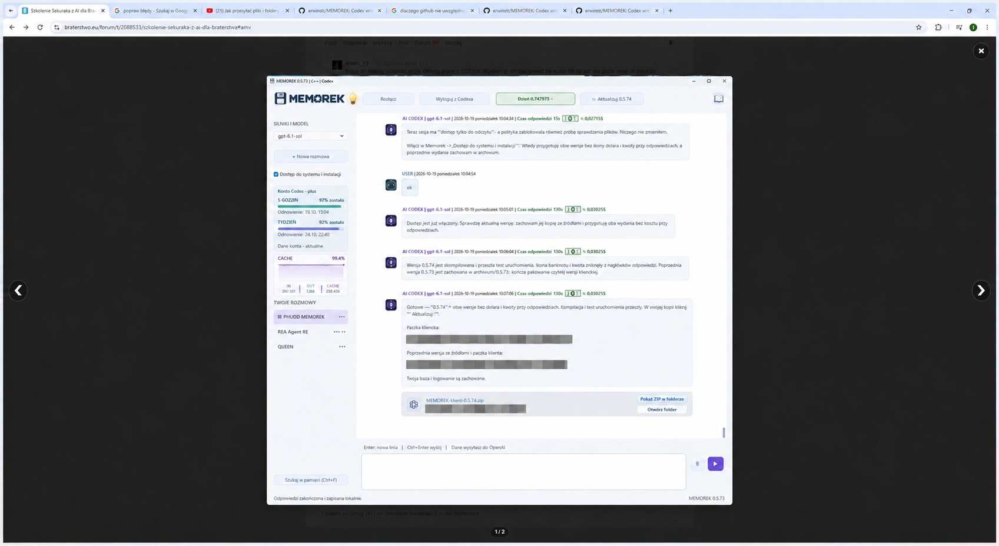
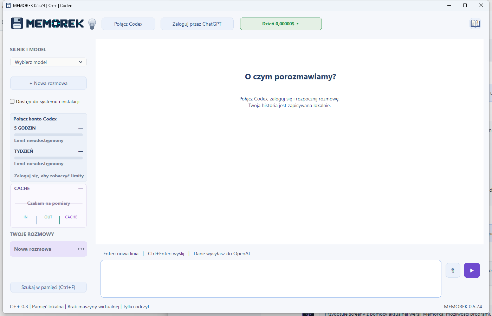
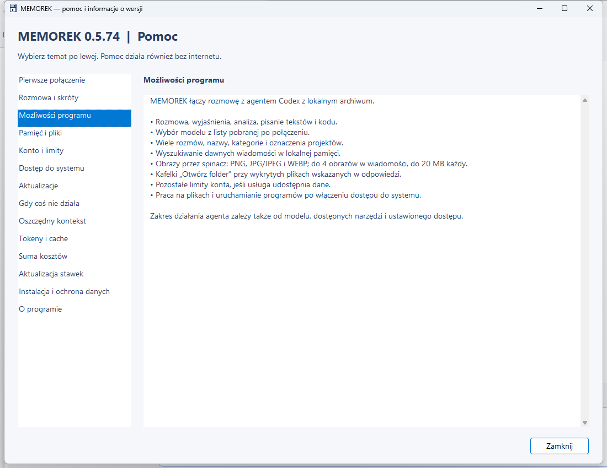
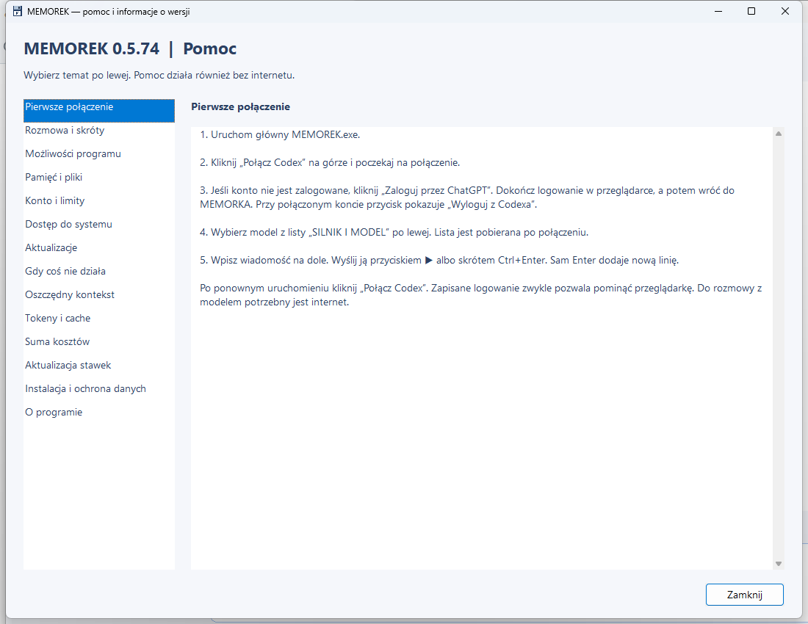
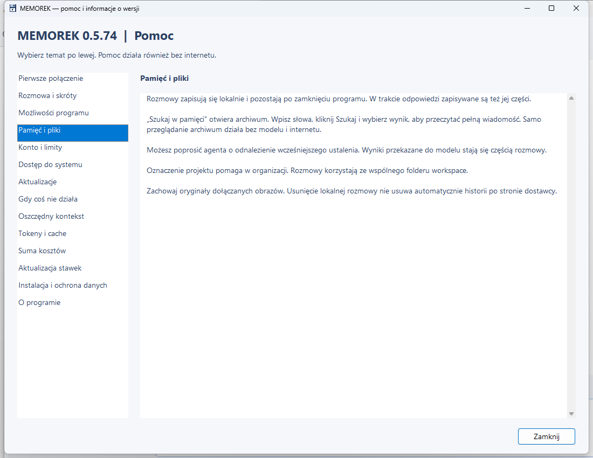
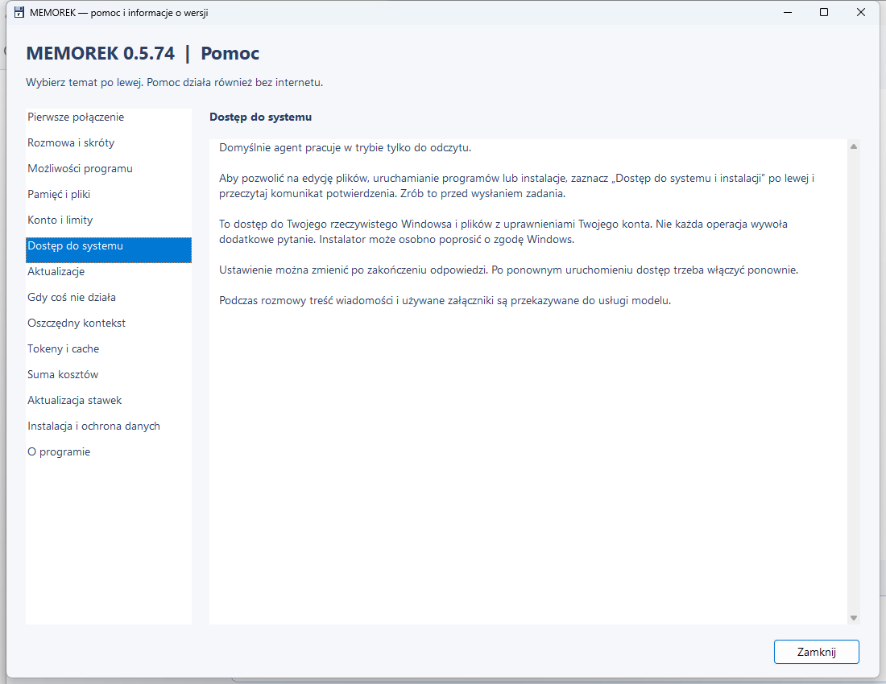
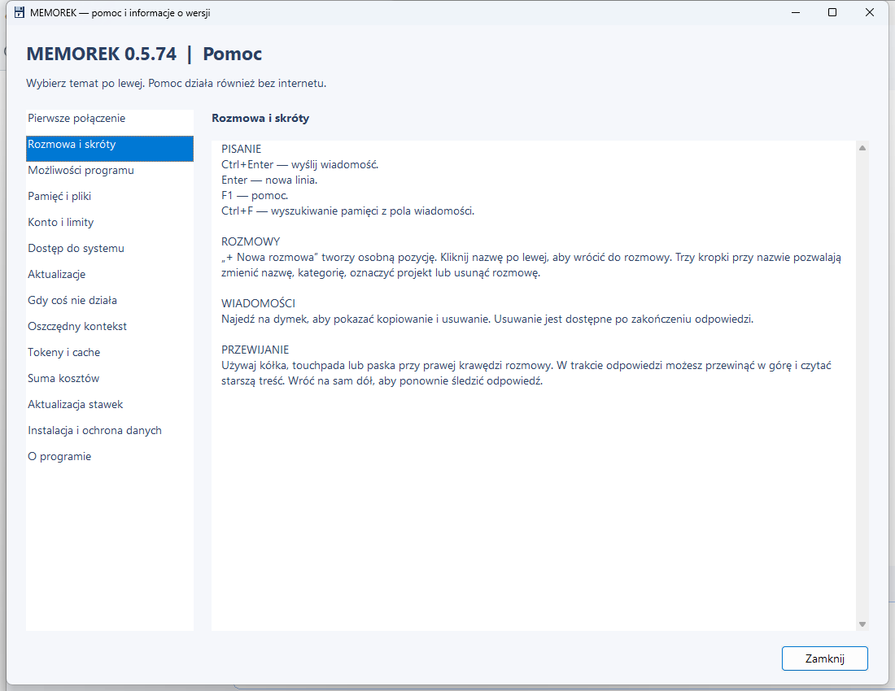

# MEMOREK

**Rozmowa z agentem AI i lokalna pamięć — w jednym oknie Windows.**

Darmowy program autorstwa **rWin**. Poniżej znajdziesz wygląd programu, jego możliwości i instrukcję obsługi na zrzutach ekranu z wersji **0.5.74**.

## Przykład pracy z agentem

MEMOREK pozwala zlecać agentowi pracę nad programem: zmiany w kodzie, kompilację, testowanie i przygotowanie paczki. Na screenie widać taką rozmowę oraz przyciski otwierania folderu z wynikiem. Ścieżki do prywatnych plików są zasłonięte. Zrzut pochodzi z wersji 0.5.73; pozostałe screeny pokazują wersję 0.5.74.

## Jak pobrać i uruchomić program?

**Paczka programu nie jest jeszcze opublikowana. Na razie ta strona zawiera instrukcję i screeny.**

Po opublikowaniu paczki:

1. Kliknij **[Pobierz program — wydania MEMORKA](https://github.com/erwinsts/MEMOREK/releases)**.
2. Otwórz najnowsze wydanie i przewiń pod jego opis.
3. Znajdź **Assets** — to lista plików do pobrania. Jeśli jest zwinięta, kliknij jej nazwę.
4. Kliknij **MEMOREK-klient-0.5.74.zip** i poczekaj na pobranie.
5. Kliknij pobrany ZIP prawym przyciskiem myszy i wybierz **Wyodrębnij wszystkie**.
6. Otwórz rozpakowany folder i uruchom **MEMOREK.exe**. Pozostaw obok niego wszystkie dołączone pliki i foldery.

**Nie pobieraj „Source code (zip)” ani „Source code (tar.gz)”** — zawierają tę stronę pomocy, a nie gotowy program.

Do uruchomienia gotowej paczki nie potrzeba kompilatora. Rozmowa z AI wymaga internetu, własnego konta i dostępu do usług dostawcy modeli. Sam MEMOREK jest darmowy; usługi AI mogą być płatne lub ograniczone limitami konta.

## Wygląd programu

## Co potrafi MEMOREK?

## Pierwsze uruchomienie i połączenie

## Pamięć rozmów i pliki

## Dostęp do systemu i instalacji

## Obsługa i skróty

## Dane i wymagania

- Windows x64, zapisywalny folder programu i pełna zawartość ZIP-a.
- `native-data` i `workspace` powstają podczas używania programu. Nie publikuj swoich rozmów ani profilu logowania.
- Zrób kopię danych przed aktualizacją. Nie uruchamiaj kilku kopii nad tą samą bazą.
- Dostęp do systemu pozwala agentowi wykonywać działania na Twoim komputerze. Sprawdzaj jego pracę.
- Licencje składników zewnętrznych są dołączone do kompletnej paczki programu.

To repozytorium zawiera wyłącznie opis, instrukcję i screeny. **Kompletny program jest dystrybuowany osobno przez Releases.**