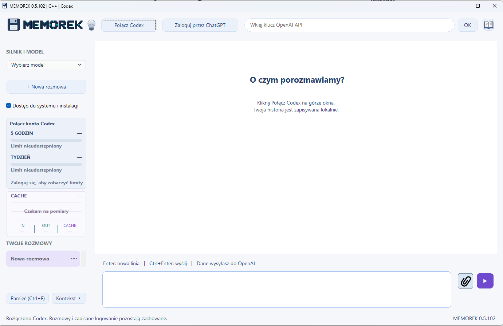

# MEMOREK — instrukcja obsługi

Darmowy program dla Windows autorstwa **rWin**. Rozmawiaj z agentem AI, dołączaj obrazy i wracaj do zapisanych rozmów. Po włączeniu dostępu do systemu możesz zlecać agentowi edycję plików, kodowanie, kompilację i instalacje.

Aktualne wydanie: **0.5.105** — [pobierz program](https://github.com/erwinsts/MEMOREK/releases/tag/v0.5.105).

Dodana optymalizacja treści.

*Aktualne okno programu w wersji 0.5.102. Kliknij obraz, aby otworzyć pełny rozmiar.*

Do rozmowy z AI potrzebujesz internetu i własnego konta z dostępem do usługi. Uruchom cały rozpakowany program w folderze z prawem zapisu na Windows x64.

## Pierwsze uruchomienie

1. Kliknij pobrany ZIP prawym przyciskiem i wybierz **Wyodrębnij wszystkie**.
2. Otwórz rozpakowany folder **MEMOREK** i uruchom **MEMOREK.exe**. Zostaw obok wszystkie dołączone pliki i foldery.
3. Kliknij **Połącz Codex** na górze okna.
4. Kliknij **Zaloguj przez ChatGPT**, dokończ logowanie w przeglądarce i wróć do programu. Możesz też zalogować się przez API, wpisując własny klucz API i zatwierdzając go przyciskiem **OK**.
5. Wybierz model z listy **SILNIK I MODEL** po lewej.
6. Wpisz wiadomość na dole. Wyślij ją fioletową strzałką lub skrótem **Ctrl+Enter**.

**Enter** dodaje nową linię. Po ponownym uruchomieniu połącz Codex; zapisane logowanie zwykle pozwala pominąć przeglądarkę.

## Co nowego w 0.5.105

Dodana optymalizacja treści.

## Logowanie własnym kluczem API

1. Kliknij **Połącz Codex** i poczekaj na połączenie.
2. Wklej własny klucz w pole **Wklej klucz OpenAI API** na górze okna i kliknij **OK**.
3. Poczekaj na sprawdzenie klucza i komunikat **Zalogowano przez API**.
4. Wybierz dostępny model z listy **SILNIK I MODEL** i rozpocznij rozmowę.

Nie wklejaj klucza do wiadomości czatu ani nie umieszczaj go na screenshotach. Zmianę konta wykonuj po zakończeniu odpowiedzi. **Wyloguj z API** wylogowuje profil używany przez MEMOREK. Logowanie przez ChatGPT pozostaje dostępne jako drugi sposób połączenia.

W trybie API panel po lewej pokazuje **szacunkowe miesięczne użycie API zarejestrowane w MEMORKU**. Kliknij panel, aby ustawić miesięczny budżet w USD. Budżet jest zapamiętywany, ale **nie blokuje kolejnych wydatków**. Szacunki opierają się na zarejestrowanych tokenach i cenniku; nie obejmują użycia klucza w innych programach i nie pokazują salda konta dostawcy.

Jeżeli klucz zostanie odrzucony, sprawdź jego poprawność, uprawnienia i dokładny komunikat błędu. Samo sprawdzenie klucza nie generuje odpowiedzi modelu.

## Obrazy i załączniki

1. Kliknij przycisk z **czarnym spinaczem** obok pola wiadomości.
2. Zaznacz obrazy. Przytrzymaj **Ctrl**, aby wybrać kilka pojedynczych plików, albo **Shift**, aby zaznaczyć zakres.
3. Kliknij **Otwórz**. Liczba na przycisku spinacza oraz komunikat na dole potwierdzają dodanie plików.
4. Dopisz pytanie i wyślij. Możesz też wysłać same obrazy — program doda prośbę o ich analizę.

Limit to **4 obrazy łącznie na wiadomość**, do **20 MB każdy**. Obsługiwane formaty: **PNG, JPG/JPEG i WEBP**. Możesz zaznaczyć obrazy naraz albo dodawać partiami. Jeśli przekroczysz limit, ostatnio wybrana partia nie zostanie dodana.

Po wysłaniu pod Twoją wiadomością pojawią się **pogrubione nazwy plików**. Kliknij nazwę, aby otworzyć obraz. MEMOREK zachowuje lokalną kopię załącznika. Spinacz nie obsługuje obecnie ZIP-ów, PDF-ów ani dowolnych innych plików.

## Rozmowy i pamięć

**+ Nowa rozmowa** tworzy osobny wątek. Wybieraj rozmowy na liście po lewej. Menu pod trzema kropkami pozwala zmienić nazwę, kategorię, oznaczyć projekt lub usunąć rozmowę.

Rozmowy zapisują się lokalnie i pozostają po zamknięciu programu. **Szukaj w pamięci** otwiera archiwum: wpisz słowa, kliknij **Szukaj** i wybierz wynik. Samo przeglądanie zapisanej pamięci działa bez internetu. Możesz też poprosić agenta o odnalezienie wcześniejszego ustalenia.

**Ctrl+F** w polu wiadomości otwiera wyszukiwanie pamięci. **F1** otwiera pomoc w programie.

## Kodowanie i dostęp do komputera

Przed wysłaniem zadania wymagającego zmian zaznacz **Dostęp do systemu i instalacji** i przeczytaj komunikat potwierdzenia. Agent może wtedy edytować pliki, uruchamiać polecenia, kompilować kod i wykonywać instalacje, zależnie od dostępnych narzędzi i uprawnień konta Windows.

Bez tej opcji działa w trybie tylko do odczytu. Podaj folder i konkretny cel, np. „Sprawdź projekt w tym katalogu i napraw błąd kompilacji”. Dostęp trzeba ponownie włączyć po uruchomieniu programu.

## Limity konta i licznik dolarów

Panel po lewej pokazuje pozostały limit konta oraz termin odnowienia, jeśli usługa udostępnia dane. **„Limit nieudostępniony”** oznacza brak danych.

Licznik **$ na górze** pokazuje szacunkową wartość według stawek API. Nie jest rachunkiem za abonament ani dokładną kwotą pobraną z konta. Kliknij licznik, aby zmienić okres lub wybrać **Wyzeruj licznik dolarów**.

## Czytanie i kopiowanie wiadomości

Przewijaj rozmowę kółkiem myszy lub paskiem po prawej. Podczas pisania odpowiedzi możesz wrócić do wcześniejszych wiadomości. Przewiń na sam dół, aby śledzić dalszy ciąg odpowiedzi.

Najedź na wiadomość, aby pokazać przyciski kopiowania i usuwania. Usuwanie jest dostępne po zakończeniu odpowiedzi.

## Jak zlecać zadania

Napisz, jaki efekt chcesz uzyskać, i podaj potrzebne szczegóły. Przykłady:

- „Wyjaśnij prostymi słowami błąd widoczny na załączonym obrazie”.
- „Znajdź w pamięci nasze ustalenia dotyczące strony firmowej”.
- „W folderze C:\Projekty\MojaStrona popraw menu na telefonach”.

Do pracy z plikami podaj dokładny folder. Przy plikach wskazanych w odpowiedzi mogą pojawić się kafelki **Otwórz folder**. Oznaczenie rozmowy jako projektu służy organizacji; rozmowy korzystają ze wspólnego folderu **workspace**.

## Konto i połączenie

**Rozłącz** kończy połączenie z Codexem. Aby wrócić do pracy, kliknij **Połącz Codex**. **Wyloguj z Codexa** wylogowuje konto używane przez MEMORKA.

Listę modeli program pobiera po połączeniu. Wybieraj model z listy **SILNIK I MODEL**.

Panel **CACHE** dotyczy wykorzystania pamięci podręcznej wejścia modelu. Nie pokazuje zajętości dysku ani zapełnienia archiwum rozmów.

## Własne dane

Folder **native-data** zawiera rozmowy, załączniki, ustawienia i profil logowania. **workspace** zawiera pliki robocze. Zamknij program przed wykonaniem kopii tych folderów. Nie publikuj własnego folderu danych.

Główna baza rozmów jest szyfrowana przez Windows DPAPI, powiązane z kontem Windows. Przeniesienie jej na inne konto lub komputer może uniemożliwić odczyt. Załączniki i profil Codexa pozostają poza tym szyfrowaniem bazy.

Wiadomości i obrazy używane w rozmowie są przekazywane do usługi AI.

## Gdy coś nie działa

| Problem | Co zrobić |
| --- | --- |
| Nie można rozpocząć rozmowy | Sprawdź internet, kliknij **Połącz Codex** i dokończ logowanie, jeśli jest wymagane. |
| Brak modeli na liście | Najpierw połącz Codex i sprawdź zalogowane konto. |
| Enter nie wysyła wiadomości | Użyj **Ctrl+Enter** albo fioletowej strzałki. |
| AI nie może zmienić pliku | Przed wysłaniem zadania włącz **Dostęp do systemu i instalacji** i podaj dokładną ścieżkę. |
| Nie można dodać obrazu | Sprawdź format, rozmiar do 20 MB i limit 4 obrazów. |
| Nie znajduję wiadomości | W **Szukaj w pamięci** spróbuj krótszego hasła lub innego słowa. |

## Skróty

| Skrót | Działanie |
| --- | --- |
| **Ctrl+Enter** | Wyślij wiadomość |
| **Enter** | Dodaj nową linię |
| **Ctrl+F** w polu wiadomości | Otwórz wyszukiwanie pamięci |
| **F1** | Otwórz pomoc |

Autor: **rWin**. MEMOREK jest darmowy; korzystanie z usług AI może wymagać opłat u dostawcy. AI może się mylić — sprawdzaj odpowiedzi i wykonywane zmiany.
