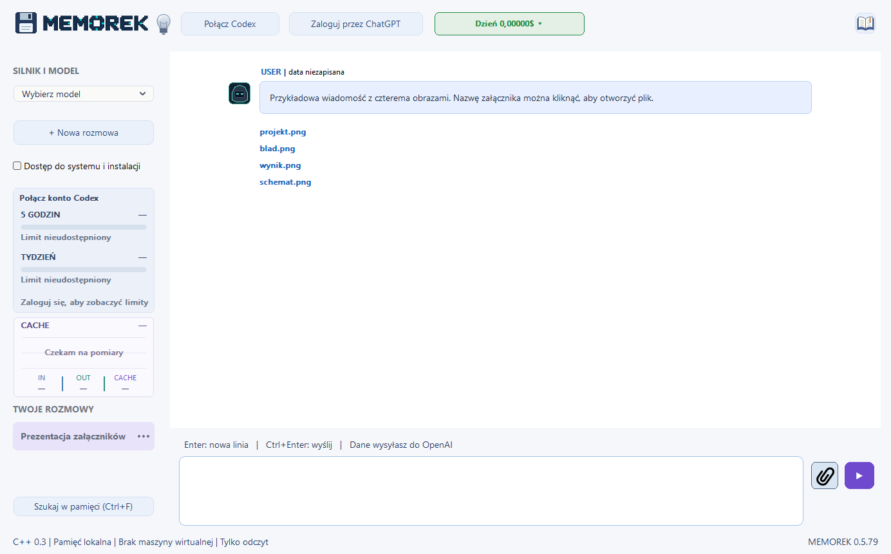

# MEMOREK 0.5.79 — pomoc

Darmowy program dla Windows autorstwa **rWin**. Rozmawiaj z agentem AI, dołączaj obrazy i wracaj do zapisanych rozmów. Po włączeniu dostępu do systemu możesz zlecać agentowi edycję plików, kodowanie, kompilację i instalacje.

Cała poniższa instrukcja dotyczy **wersji 0.5.79**.

*Aktualne okno programu na profilu demonstracyjnym. Kliknij obraz, aby otworzyć pełny rozmiar.*

## Pobieranie i wymagania

**ZIP 0.5.79 jest przygotowany, ale wydanie nie zostało jeszcze opublikowane w Releases.**

Po publikacji otwórz **[Wydania MEMORKA](https://github.com/erwinsts/MEMOREK/releases)**. Pod opisem wydania rozwiń **Assets** i pobierz **MEMOREK-klient-0.5.79.zip**. Automatyczne pliki „Source code” zawierają tę pomoc, a nie gotowy program.

Potrzebujesz **Windows x64**, folderu z prawem zapisu oraz internetu do rozmowy z AI. Kompilator nie jest potrzebny. Używasz własnego konta; dostęp do modeli i limity zależą od usługi AI. Sam MEMOREK jest darmowy.

## Pierwsze uruchomienie

1. Kliknij pobrany ZIP prawym przyciskiem i wybierz **Wyodrębnij wszystkie**.
2. Otwórz rozpakowany folder **MEMOREK** i uruchom **MEMOREK.exe**. Zostaw obok wszystkie dołączone pliki i foldery.
3. Kliknij **Połącz Codex** na górze okna.
4. Kliknij **Zaloguj przez ChatGPT**, dokończ logowanie w przeglądarce i wróć do programu.
5. Wybierz model z listy **SILNIK I MODEL** po lewej.
6. Wpisz wiadomość na dole. Wyślij ją fioletową strzałką lub skrótem **Ctrl+Enter**.

**Enter** dodaje nową linię. Po ponownym uruchomieniu połącz Codex; zapisane logowanie zwykle pozwala pominąć przeglądarkę.

## Obrazy i załączniki

1. Kliknij przycisk z **czarnym spinaczem** obok pola wiadomości.
2. Zaznacz obrazy. Przytrzymaj **Ctrl**, aby wybrać kilka pojedynczych plików, albo **Shift**, aby zaznaczyć zakres.
3. Kliknij **Otwórz**. Liczba na przycisku spinacza oraz komunikat na dole potwierdzają dodanie plików.
4. Dopisz pytanie i wyślij. Możesz też wysłać same obrazy — program doda prośbę o ich analizę.

Limit to **4 obrazy łącznie na wiadomość**, do **20 MB każdy**. Obsługiwane formaty: **PNG, JPG/JPEG i WEBP**. Możesz zaznaczyć obrazy naraz albo dodawać partiami. Jeśli przekroczysz limit, ostatnio wybrana partia nie zostanie dodana.

Po wysłaniu pod Twoją wiadomością pojawią się **pogrubione nazwy plików**. Kliknij nazwę, aby otworzyć obraz. MEMOREK zachowuje lokalną kopię załącznika. Spinacz nie obsługuje obecnie ZIP-ów, PDF-ów ani dowolnych innych plików.

## Rozmowy i pamięć

**+ Nowa rozmowa** tworzy osobny wątek. Wybieraj rozmowy na liście po lewej. Menu pod trzema kropkami pozwala zmienić nazwę, kategorię, oznaczyć projekt lub usunąć rozmowę.

Rozmowy zapisują się lokalnie i pozostają po zamknięciu programu. **Szukaj w pamięci** otwiera archiwum: wpisz słowa, kliknij **Szukaj** i wybierz wynik. Samo przeglądanie zapisanej pamięci działa bez internetu. Możesz też poprosić agenta o odnalezienie wcześniejszego ustalenia.

**Ctrl+F** w polu wiadomości otwiera wyszukiwanie pamięci. **F1** otwiera pomoc w programie.

## Kodowanie i dostęp do komputera

Przed wysłaniem zadania wymagającego zmian zaznacz **Dostęp do systemu i instalacji** i przeczytaj komunikat potwierdzenia. Agent może wtedy edytować pliki, uruchamiać polecenia, kompilować kod i wykonywać instalacje, zależnie od dostępnych narzędzi i uprawnień konta Windows.

Bez tej opcji działa w trybie tylko do odczytu. Podaj folder i konkretny cel, np. „Sprawdź projekt w tym katalogu i napraw błąd kompilacji”. Dostęp trzeba ponownie włączyć po uruchomieniu programu.

## Limity konta i licznik dolarów

Panel po lewej pokazuje pozostały limit konta oraz termin odnowienia, jeśli usługa udostępnia dane. **„Limit nieudostępniony”** oznacza brak danych.

Licznik **$ na górze** pokazuje szacunkową wartość według stawek API. Nie jest rachunkiem za abonament ani dokładną kwotą pobraną z konta. Kliknij licznik, aby zmienić okres lub wybrać **Wyzeruj licznik dolarów**.

## Aktualizacja i własne dane

Gdy program wykryje przygotowaną nowszą wersję, na górze pojawia się **Aktualizuj**. Aktualizator czeka na zakończenie odpowiedzi i zapis rozmowy, następnie podmienia program i uruchamia go ponownie.

Własne dane są w **native-data**, a pliki robocze we **workspace**. Zachowaj ich kopię przed przenoszeniem lub aktualizacją. Nie zastępuj własnego folderu danych pustą kopią. Paczka kliencka jest przygotowana bez rozmów i logowania autora.

Wiadomości i załączniki używane w rozmowie są przekazywane do usługi AI. Nie publikuj własnego folderu danych razem z programem.
