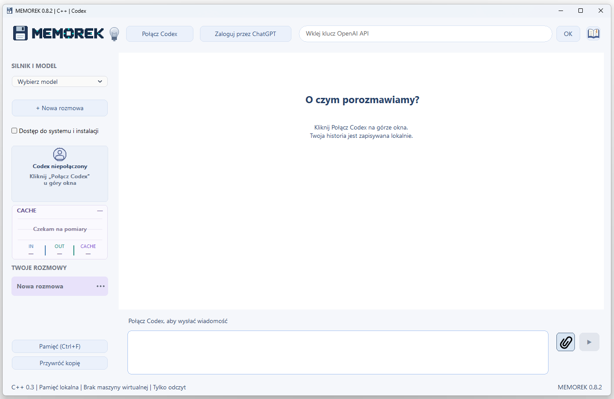

# MEMOREK — instrukcja obsługi

Darmowy program dla Windows autorstwa **rWin**.

Aktualne wydanie: **0.8.2** — [pobierz pełny program](https://github.com/erwinsts/MEMOREK/releases/tag/v0.8.2).

**Co nowego:** Automatyczne przywracanie rozmów i cofanie przywrócenia, szyfrowana baza na dysku oraz bieżąca kopia i siedem kopii dziennych.

## Okno programu

Na górze znajdują się „Połącz Codex”, „Zaloguj przez ChatGPT” i pole klucza OpenAI API z przyciskiem „OK”. Model wybierasz po lewej w sekcji „SILNIK I MODEL”. Ikona książki w prawym górnym rogu otwiera pomoc; działa też F1.

Lewa kolumna zawiera „+ Nowa rozmowa”, ustawienie dostępu do systemu, panel konta, wykres CACHE oraz listę rozmów. Na dole są „Pamięć (Ctrl+F)” i „Przywróć kopię”. Wiadomość wpisujesz na dole głównego obszaru; obok znajdują się spinacz i przycisk wysyłania ▶.

## Pierwsze połączenie

Rozpakuj cały folder MEMOREK i uruchom MEMOREK.exe. Nie uruchamiaj programu bezpośrednio z ZIP-a.

Kliknij „Połącz Codex” i poczekaj na połączenie. Zaloguj się przez ChatGPT w przeglądarce albo wpisz własny klucz API w polu na górze i kliknij „OK”. Nie wpisuj klucza do rozmowy.

Wybierz dostępny model z listy „SILNIK I MODEL”. Wpisz wiadomość i wyślij przyciskiem ▶ lub Ctrl+Enter. Enter dodaje nową linię.

Przy kolejnym uruchomieniu ponownie połącz Codex. Zapisany profil zwykle pozwala pominąć logowanie. Rozmowa z modelem wymaga internetu i własnego dostępu do usługi.

## Rozmowa i skróty

Ctrl+Enter — wysłanie wiadomości. Enter — nowa linia. F1 — pomoc. Ctrl+F w polu wiadomości — wyszukiwanie w pamięci.

„+ Nowa rozmowa” tworzy osobny wątek. Wybierz rozmowę na liście po lewej, aby do niej wrócić. Menu pod trzema kropkami pozwala zmienić nazwę, kategorię, oznaczenie projektu lub usunąć rozmowę.

Podczas generowania odpowiedzi możesz pisać szkic kolejnego pytania. Wysłanie jest dostępne po zakończeniu odpowiedzi. Przycisk wysyłania jest szary i nieaktywny bez połączenia lub logowania, podczas łączenia, logowania i trwającej odpowiedzi. Komunikat nad polem wiadomości podaje przyczynę. Ta sama blokada obejmuje Ctrl+Enter. Stan pracy i czas opisują obsługę zadania; nie są pomiarem wewnętrznego rozumowania modelu.

Najedź na wiadomość, aby zobaczyć kopiowanie i usuwanie. Przewijaj kółkiem, touchpadem lub paskiem. Przewinięcie w górę pozwala czytać starszą treść; powrót na dół przywraca śledzenie odpowiedzi.

Podczas pracy agenta zamknięcie programu przyciskiem X, opcją Zamknij lub skrótem Alt+F4 jest zablokowane. Po zakończeniu zadania zamykanie jest ponownie dostępne.

## Obrazy i pliki

Spinacz obok pola wiadomości dodaje obrazy PNG, JPG/JPEG i WEBP. Limit wynosi 4 obrazy na wiadomość, do 20 MB każdy. W oknie wyboru użyj Ctrl lub Shift, aby zaznaczyć kilka obrazów naraz. Możesz też dodawać je partiami.

Dopisz pytanie i wyślij. Gdy wysyłasz same obrazy, program dodaje prośbę o ich analizę. Po wysłaniu nazwy załączników są widoczne pod wiadomością; kliknięcie otwiera lokalny plik. Program zachowuje kopie obrazów w native-data/attachments.

Spinacz nie służy do dołączania dowolnych PDF-ów, ZIP-ów i innych dokumentów. Pliki robocze udostępniaj agentowi przez folder workspace i podanie ścieżki. Możliwość ich odczytu lub zmiany zależy od uprawnień i narzędzi. Kafelki „Otwórz folder” przy rozpoznanych ścieżkach pozwalają przejść do plików.

## Wyszukiwanie w bazie

Uproszczono obsługę wyszukiwania w bazie danych.

Kliknij „Pamięć (Ctrl+F)”, wpisz nazwę, słowa lub ustalenie i naciśnij Enter albo „Szukaj”. Wybierz wynik, aby czytać wiadomość z autorem i datą. Dłuższy tekst przeglądaj przyciskami „← Fragment” i „Fragment →”. Przyciski „Poprzednia” i „Następna” przełączają strony wyników. Wyszukiwanie i podgląd działają lokalnie, również bez internetu.

W rozmowie możesz poprosić agenta o odnalezienie wcześniejszych ustaleń. Agent ma narzędzia przeszukujące całą lokalną bazę oraz odczytujące wskazane wiadomości i sąsiednie źródła. Do usługi trafiają tylko zwrócone wyniki i potrzebne fragmenty. Program nie wysyła automatycznie całej bazy ani nie dokleja podobnych źródeł do każdego pytania.

Usunięto przyciski „Kontekst”, „Pracuj na tym kontekście”, pracę tylko na temacie oraz tryby 3/5 wymian. Dawne ograniczenia są wyłączane przy odczycie archiwum; wiadomości pozostają zachowane.

Źródła z bazy mogą zawierać stare propozycje i nieaktualne ustalenia. Sprawdzaj autora, datę i pełny zapis, gdy szczegół ma znaczenie.

## Historia rozmowy

Bieżąca rozmowa korzysta z zachowanego wątku modelu. Program nie resetuje go po 5 pytaniach ani po 16000 tokenów i nie narzuca celu 20000 tokenów wejścia. Granicę kontekstu i ewentualne kompaktowanie obsługuje backend modelu.

Nowa rozmowa tworzy oddzielny wątek, ale lokalne archiwum wszystkich rozmów pozostaje dostępne do wyszukiwania. Jeżeli stary wątek nie jest dostępny lub po migracji powstał nowy, agent może odszukać wcześniejsze ustalenia narzędziami pamięci. Program nie odtwarza go przez automatyczne wysyłanie całej bazy.

Zachowanie wątku sprzyja ponownemu wykorzystaniu cache, ale nie gwarantuje konkretnego procentu ani pamiętania każdego szczegółu. Ważne ustalenia można zweryfikować w lokalnym archiwum.

## Historia na dysku i kopie automatyczne

Rozmowy i indeks wyszukiwania są przechowywane w szyfrowanej bazie `native-data/archive.db`. Program wczytuje zapisane wiadomości stronami zamiast trzymać całą historię w pamięci RAM. Długie wiadomości mogą mieć skrócony podgląd; kopiowanie odczytuje pełny tekst, a w oknie „Pamięć” można przechodzić między fragmentami.

Po aktualizacji ze starszej wersji dotychczasowa historia jest automatycznie przenoszona do nowej bazy. Stary plik zostaje zachowany pod nazwą `conversations.json.before-database-...`. Przeniesienie dużej historii może potrwać i wymaga miejsca na starą oraz nową bazę.

Po zakończeniu odpowiedzi agenta program odświeża bieżącą kopię całej bazy. Dodatkowo zachowuje do siedmiu kopii dziennych — po jednej na dzień używania programu. Kopia dzienna powstaje po pierwszym zapisie danego dnia i nie jest nadpisywana kolejnymi odpowiedziami. Po utworzeniu ósmej usuwana jest najstarsza kopia dzienna. Kopie trafiają do `native-data/database-backups` i pozostają zaszyfrowane.

Kopie powstają w tle. Przy dużej bazie wykonanie i sprawdzenie pełnej kopii zajmuje czas. Komunikat „Rozmowa zapisana i zabezpieczona. Kopia bieżąca jest aktualna” potwierdza zakończenie zabezpieczania. Błąd kopii nie oznacza, że sama rozmowa nie została zapisana.

## Przywracanie rozmów

1. Poczekaj na zakończenie pracy agenta.
2. Kliknij „Przywróć kopię” pod przyciskiem „Pamięć” po lewej stronie.
3. W otwartym oknie przeczytaj opis i kliknij „Przywróć kopię”.
4. Program wybierze najnowszą poprawną kopię, zabezpieczy obecną historię i przeprowadzi przywracanie. Nie wybierasz daty, pliku ani klucza.
5. Sprawdź podsumowanie liczby rozmów i wiadomości przed operacją oraz po niej. Aby wrócić do poprzedniego stanu, użyj „Cofnij przywrócenie” w tym samym oknie.

Niepoprawne lub nieczytelne kopie są pomijane. Jeżeli nie ma poprawnej kopii, historia pozostaje bez zmian. Podczas przywracania edycja rozmów i zamknięcie programu są zablokowane. Jeśli operacja zostanie przerwana, program spróbuje dokończyć ją przy następnym uruchomieniu.

Przywracanie zastępuje historię stanem z kopii; nie łączy dwóch historii. Nowsze wiadomości pozostają w osobnym zabezpieczeniu, dostępnym przez cofnięcie operacji. Zabezpieczenia są przechowywane w `native-data/restore-safety`, osobno od siedmiu kopii dziennych, i zajmują dodatkowe miejsce na dysku.

Kopia bazy nie odtwarza usuniętych zdjęć ani innych plików załączników. Istniejące pliki pozostają na dysku. Przywracanie lokalnej historii nie cofa stanu rozmowy po stronie dostawcy; przywrócone rozmowy rozpoczynają świeży wątek AI z dostępem do lokalnej pamięci.

## Tokeny i wykres cache

Wykres CACHE po lewej pokazuje do 24 ostatnich pomiarów wybranej rozmowy, od najstarszego do najnowszego. Punkt opisuje ostatnie wywołanie modelu w danej turze. Jedna odpowiedź może wymagać kilku wywołań, np. przy używaniu narzędzi.

IN oznacza tokeny wejściowe, OUT — wyjściowe, CACHE — część wejścia ponownie wykorzystaną przez dostawcę. Cache jest częścią IN, więc nie dodawaj tych dwóch liczników. Pod wykresem są wartości ostatniego wywołania, a nie suma całej odpowiedzi. Najedź myszą, aby zobaczyć szczegóły.

Wysoki cache nie oznacza gotowej odpowiedzi z pamięci ani takiego samego procentu oszczędności limitu konta. Cache zależy od treści, modelu i dostawcy; 99,9% nie jest gwarantowane. Program nie wysyła dodatkowych pytań, aby go podtrzymywać.

Kliknij wykres prawym przyciskiem myszy i wybierz „Resetuj wykres — licz od teraz”, aby ukryć wcześniejsze punkty. To nie usuwa historii pomiarów ani nie zeruje licznika dolarów. W trybie API kliknięcie lewym przyciskiem przełącza widok cache i kosztu.

## Szacunkowe koszty

Licznik dolarów na górze pokazuje szacunek według cennika API dla zarejestrowanych wywołań. Kliknij go, aby wybrać godzinę, dzień, tydzień lub miesiąc oraz zobaczyć sumę tokenów. Zliczane są wszystkie zarejestrowane wywołania ze wszystkich rozmów, także pośrednie wywołania narzędzi.

Nie jest to faktura, saldo konta ani koszt abonamentu ChatGPT. W trybie ChatGPT jest to przeliczenie tokenów według stawek API, a nie informacja o dodatkowej opłacie. Gwiazdka oznacza nieznaną stawkę lub niepełną historię; suma może być częściowa.

„Wyzeruj licznik dolarów” rozpoczyna nowe podsumowanie od tej chwili. Nie usuwa zapisanych pomiarów, nie zmienia wykresu i nie zeruje rachunku u dostawcy.

Budżet miesięczny w panelu API jest oddzielną funkcją. Nie stanowi blokady wydatków.

## Logowanie API i budżet

Połącz Codex, wpisz własny klucz API w polu na górnym pasku i kliknij „OK”. Poczekaj na wynik sprawdzenia. Nie umieszczaj klucza w wiadomościach, repozytorium ani na zrzutach ekranu. Logowanie przez ChatGPT jest alternatywną metodą.

W trybie API panel po lewej pokazuje szacunkowe miesięczne użycie zarejestrowane w MEMORKU. Kliknij panel, aby ustawić budżet w USD. Ustawiony budżet nie blokuje kolejnych wydatków.

Szacunek nie obejmuje użycia klucza w innych programach i nie przedstawia salda konta. Korzysta z pomiarów tokenów oraz dostępnego cennika. Zmieniaj konto po zakończeniu odpowiedzi. „Wyloguj z API” wylogowuje profil MEMORKA.

Odrzucony klucz: sprawdź dokładny komunikat, poprawność i uprawnienia klucza. Samo sprawdzenie logowania nie generuje odpowiedzi modelu.

## Konto i limity ChatGPT

Po połączeniu i zalogowaniu przez ChatGPT panel po lewej pokazuje w planie Free miesięczny pasek zużycia, procent pozostałego limitu i termin odnowienia, jeżeli konto udostępnia te dane. W Plus pozostają paski 5-godzinny i tygodniowy.

„58% zostało” oznacza pozostały limit. „Limit nieudostępniony” oznacza brak danych, a nie zero. Program pobiera je po połączeniu i odświeża co minutę; sprawdzenie nie wysyła pytania do modelu.

Procent cache oraz licznik dolarów nie pokazują pozostałego limitu konta. Profil logowania MEMORKA jest osobny od sesji otwartej w przeglądarce. Lista dostępnych modeli zależy od konta i odpowiedzi backendu.

## Dostęp do systemu

Domyślnie agent pracuje tylko do odczytu. Aby umożliwić edycję plików, uruchamianie programów lub instalacje, zaznacz „Dostęp do systemu i instalacji” i przeczytaj komunikat potwierdzenia przed wysłaniem zadania.

Agent pracuje na rzeczywistych plikach Windows z uprawnieniami Twojego konta. Nie każda operacja wymaga dodatkowego pytania. Instalator może osobno poprosić o zgodę Windows. Program nie jest maszyną wirtualną.

Ustawienie zmieniaj po zakończeniu odpowiedzi. Po ponownym uruchomieniu dostęp trzeba włączyć ponownie. Wszystkie rozmowy korzystają ze wspólnego folderu workspace; oznaczenie projektu nie tworzy osobnej piaskownicy.

Treść wiadomości, wysłane obrazy oraz dane odczytane przez narzędzia mogą trafić do usługi modelu podczas obsługi zadania.

## Aktualizacje

Program sprawdza publiczne wydania w repozytorium erwinsts/MEMOREK na GitHubie przy uruchomieniu i co godzinę. Sprawdzanie nie wymaga konta GitHub.

Po wykryciu nowszej kompletnej paczki pojawia się przycisk „Aktualizuj” z numerem wersji. Pobieranie i instalacja zaczynają się po kliknięciu. Lokalne pakiety przygotowane przez kompilację są również obsługiwane.

Aktualizator sprawdza sumę SHA-256 i spis plików, czeka na zakończenie odpowiedzi i zapis rozmowy, zachowuje poprzednie pliki, podmienia program i uruchamia go ponownie. Błąd instalacji powoduje próbę przywrócenia poprzednich plików.

Rozmowy, workspace i profil logowania pozostają na miejscu. Okno zmian zamknij krzyżykiem albo zaznacz opcję automatycznego zamknięcia po aktualizacji. Brak internetu lub nowego wydania nie blokuje programu.

Przy ręcznej aktualizacji zamknij program, zachowaj kopię native-data i workspace, a następnie podmień pliki programu z nowej pełnej paczki.

## Połączenie i rozłączanie

„Połącz Codex” uruchamia lokalny backend dostarczony z programem. „Rozłącz” zamyka połączenie po zakończeniu bieżącej operacji. Możesz potem połączyć się ponownie.

Lokalny proces i profil logowania nie są lokalnym modelem językowym. Generowanie odpowiedzi wymaga połączenia z usługą. Program nie wysyła podtrzymujących pytań do modelu i nie gwarantuje utrzymania cache.

Jeżeli połączenie utknie, zachowaj ważny tekst, zaczekaj na zakończenie bieżącej pracy i uruchom program ponownie. Nie usuwaj profilu logowania ani bazy w ramach zwykłego restartu.

## Cennik modeli

Szacunki kosztów korzystają z lokalnego cennika oraz pomiarów tokenów. Stawki dla zwykłego wejścia, wejścia z cache i wyjścia są rozliczane oddzielnie. Dla części modeli długi kontekst może mieć inną stawkę.

Nieznana nazwa modelu lub brak stawki oznacza brak pełnego szacunku, a nie bezpłatną pracę. Program nie wylicza kosztu z samej liczby znaków.

Do odświeżenia lokalnych stawek służy dołączony skrypt refresh_pricing.ps1. Nie wpisuj stawek na podstawie przypuszczeń. Ostateczne rozliczenie sprawdzaj u dostawcy; lokalne dane nie są fakturą.

## Instalacja i prywatne dane

Wymagania: Windows 10/11 x64, Windows PowerShell 5.1, folder z prawem zapisu, internet i własny dostęp do usługi AI. Kompilator, Python i Node.js nie są wymagane do zwykłego uruchamiania. Zadania agenta mogą wymagać dodatkowych narzędzi.

Zachowaj cały folder programu wraz z tools/codex. Nie uruchamiaj kilku kopii na tej samej bazie. Native-data zawiera rozmowy, załączniki, ustawienia i profil logowania; workspace zawiera pliki robocze. Nie publikuj tych folderów.

Główna baza rozmów, indeks wyszukiwania i kopie bazy są szyfrowane przez SQLCipher. Klucz w `native-data/archive.key` jest chroniony przez Windows DPAPI związane z kontem Windows. Program odczytuje potrzebne dane do RAM. Profil i sesje Codexa, załączniki oraz pomiary zużycia pozostają poza szyfrowaniem tej bazy.

Przeniesienie zaszyfrowanej bazy na inne konto Windows lub komputer może uniemożliwić odczyt. Brak przenośnego eksportu. Przed ręcznym przenoszeniem lub aktualizacją zachowaj kopię native-data i workspace. Usunięcie rozmowy lokalnie nie usuwa automatycznie danych po stronie dostawcy ani starszych kopii.

## Gdy coś nie działa

Nie można wysłać wiadomości: połącz Codex, sprawdź logowanie, wpisz tekst lub dodaj obraz i poczekaj na zakończenie poprzedniej odpowiedzi.

Pusta lista modeli lub błąd logowania: sprawdź internet, metodę logowania i dokładny komunikat. Konto w przeglądarce nie zastępuje profilu MEMORKA.

Brak wyników wyszukiwania: spróbuj innej nazwy lub krótszego zestawu słów. Sam lokalny podgląd nie wymaga modelu. Starszych ustaleń można też szukać przez agenta.

Agent nie może zmienić pliku: sprawdź dostęp do systemu i prawa do folderu. Ustawienia dostępu zmieniaj po zakończeniu odpowiedzi.

Brak limitu lub kosztu: konto może nie udostępniać danych, a cennik może nie zawierać modelu. Brak danych nie oznacza zera.

Brak rozmów po przypadkowym usunięciu: użyj „Przywróć kopię” i przeczytaj podsumowanie. Jeśli przywrócony stan nie jest właściwy, wybierz „Cofnij przywrócenie”.

Błąd zapisu bazy: skopiuj ważny tekst, zachowaj native-data i dokładny komunikat. Nie usuwaj archiwum. Błąd aktualizacji: zachowaj poprzednie pliki i komunikaty aktualizatora.

Zgłaszając problem, podaj numer wersji, kroki odtworzenia i treść błędu, bez kluczy API i prywatnych rozmów.

## Co nowego w 0.8.2

- Dodano „Przywróć kopię” pod przyciskiem „Pamięć”. Program sam wybiera najnowszą poprawną kopię wszystkich rozmów i pokazuje podsumowanie.
- Przed przywróceniem zabezpieczana jest obecna historia. Przycisk „Cofnij przywrócenie” pozwala wrócić do stanu sprzed operacji.
- Przerwane przywracanie jest automatycznie kończone przy następnym uruchomieniu programu.
- Od poprzedniego wydania 0.7.5 historia i indeks wyszukiwania są przechowywane w szyfrowanej bazie na dysku. Wiadomości są wczytywane stronami, co ogranicza zużycie RAM.
- Automatycznie powstaje bieżąca kopia bazy po odpowiedzi agenta oraz do siedmiu kopii dziennych.
- Pierwsze uruchomienie po aktualizacji przenosi dotychczasową historię do nowej bazy i zachowuje stary plik.

## O programie

MEMOREK 0.8.2

Darmowy program autorstwa rWin. Natywna aplikacja Windows napisana w C++/Win32, łącząca rozmowę z agentem Codex i lokalne archiwum. Nie zawiera własnego modelu językowego. Dostęp do usług AI może wymagać opłat lub własnego abonamentu.

Autor projektu nie ponosi odpowiedzialności za używanie programu. Wszystko robisz na własną odpowiedzialność. AI może popełniać błędy. Sprawdzaj istotne odpowiedzi i działania wykonywane na plikach.

Licencje składników zewnętrznych są dołączone w folderze licenses. Repozytorium i aktualizacje: https://github.com/erwinsts/MEMOREK.
